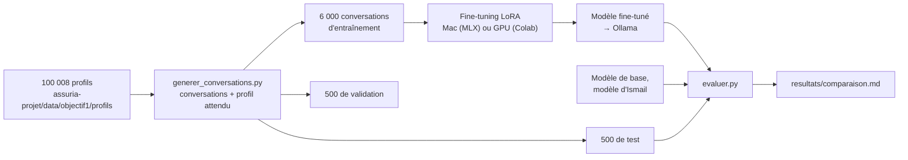

# AssurIA : petit modèle fine-tuné pour construire le profil de l'assuré

L'agent de recommandation doit d'abord comprendre **qui est le client**, à partir de la conversation. Ici, on apprend
à un **petit modèle de langage local** (0,5 à 1,5 milliard de paramètres) à lire la conversation conseiller ↔ client et à
en sortir le profil en JSON (28 champs : conducteur, permis, antécédents, véhicule, usage, couverture, budget).

Dépôt de travail personnel (Adam Hassen) pour l'objectif 1 du projet [AssurIA](https://github.com/adam-hassen/assuria-projet).
Cette approche est comparée à celle d'Ismail (modèle sous Ollama, sans entraînement) sur le **même jeu de test**.

## Idée



Le profil attendu ne contient **que ce que le client a dit** : une information jamais donnée reste `null`. Le modèle apprend
ainsi à ne rien inventer, ce qu'on mesure à part (taux d'« inventions »).

## Les fichiers

| Fichier | Rôle |
| --- | --- |
| `schema.py` | Les 28 champs du profil et la consigne donnée au modèle (la même pour tous les modèles comparés) |
| `simuler_clients.py` | Crée les conversations (version 2) en rejouant le déroulé de l'application avec des clients simulés |
| `test_ecrit.py` | 30 conversations de test écrites à la main (cas difficiles), avec le profil attendu |
| `generer_conversations.py` | Première version des conversations (modèles de phrases), gardée pour ses banques d'expressions |
| `donnees/` | `train.jsonl` (6 000), `valid.jsonl` (500), `test.jsonl` (500) au format chat, `test_conversations.jsonl` pour l'évaluation, `test_ecrit*.jsonl` (30 conversations écrites à la main) |
| `entrainer_mac.sh`, `lora_mac.yaml` | Fine-tuning LoRA sur Mac Apple Silicon avec MLX (réglages dans le YAML), puis fusion du modèle |
| `entrainer_gpu.py` | Même fine-tuning sur GPU NVIDIA (Google Colab, Kaggle) |
| `vers_ollama.sh` | Convertit le modèle fine-tuné en GGUF et le crée dans Ollama |
| `evaluer.py` | Mesure un modèle sur le jeu de test et compare tous les modèles évalués |

## Les conversations

**Version 2 (`simuler_clients.py`).** La première version posait ses propres questions, souvent plusieurs à la fois, et
le client répondait par des phrases complètes (« le permis B depuis 2015 »). Dans l'application, le conseiller pose une
question à la fois, dans son ordre, et les clients répondent court (« 2020 », « Comptant », « le mans ») : le modèle de
base échouait justement sur ces réponses. La version 2 rejoue exactement le déroulé de l'application :

- mêmes questions, même ordre, mêmes questions sautées (pas de franchise au tiers, pas d'antécédents pour un premier
  contrat, conduite accompagnée pour les conducteurs novices…), message ajouté par la plaque d'immatriculation ;
- cinq styles de clients : court (30 %), phrases (30 %), familier avec fautes et sans accents (20 %), bavard qui ajoute
  des informations (12 %), hésitant qui refuse souvent (8 %) ;
- refus (« je préfère ne pas répondre ») et « je ne sais pas » : la case reste vide ;
- réponses à convertir : « 2020 » → 6 ans de permis, « je suis né en 1990 » → 36 ans, « je l'ai eu à 18 ans »,
  « elle a 5 ans », « 12k », « un peu de tout » → usage professionnel ;
- réponses à côté (« c'est obligatoire ? ») suivies de la relance du conseiller ;
- clients de 20 pays européens, permis du monde entier, bonus-malus de chaque pays ;
- la moitié des exemples sont coupés juste après un message du client, avec le profil attendu à ce moment-là : c'est ce
  que voit le petit modèle dans l'application, qui l'appelle après chaque message.

Règle d'étiquetage : le profil attendu ne contient que ce que le client a dit (ou ce qui s'en déduit sans doute
possible, comme le pays d'une ville).

**Jeu de test écrit à la main (`test_ecrit.py`).** 30 conversations jouées comme des clients différents, qui ne sortent
d'aucun générateur : étudiant qui écrit en SMS, retraité qui fait des phrases, client qui refuse presque tout, résidents
allemand, italien, britannique ou polonais, permis marocain ou algérien, conducteur résilié, chauffeur VTC, nombres en
lettres, année de naissance au lieu de l'âge, conversations interrompues. Il sert à vérifier que le modèle ne réussit
pas seulement sur les tournures de ses données d'entraînement.

Limite à dire dans le rapport : toutes ces conversations sont simulées (générateur ou jeu de rôle), aucune ne vient de
vrais clients. Pour une mesure sur de vraies conversations, il faudra faire jouer des volontaires dans l'application à
partir de fiches personnage.

## Lancer le fine-tuning

### Sur Mac (Apple Silicon, 16 Go conseillés)

Depuis le dossier du dépôt :

```bash
# essai rapide (petit modèle, ~20 min)
bash entrainer_mac.sh Qwen/Qwen2.5-0.5B-Instruct 300

# entraînement complet (1 passage sur les 6 000 conversations)
bash entrainer_mac.sh Qwen/Qwen2.5-1.5B-Instruct 1500
```

Le modèle de base est téléchargé depuis Hugging Face au premier lancement. Le résultat est dans
`modeles/<modele>/fusionne` (ce dossier n'est pas envoyé sur GitHub, il est trop gros).

### Sur Google Colab (GPU T4 gratuit)

```python
!git clone https://github.com/adam-hassen/assuria-profil-slm.git
%cd assuria-profil-slm
!pip install -q "transformers>=4.45" "peft>=0.13" accelerate datasets
!python entrainer_gpu.py --modele Qwen/Qwen2.5-1.5B-Instruct
```

Réglages communs aux deux : LoRA, taux d'apprentissage 1e-4, lots de 4, 1 passage, conversations jusqu'à 2 048 jetons,
perte calculée uniquement sur la réponse JSON.

### Mettre le modèle dans Ollama

```bash
bash vers_ollama.sh modeles/qwen2.5-1.5b-instruct/fusionne assuria-profil
ollama run assuria-profil
```

## Évaluer et comparer

Tous les modèles reçoivent la même consigne et les mêmes conversations de test : les 500 conversations simulées
(par défaut) et les 30 conversations écrites à la main (`--jeu ecrit`).

```bash
# modèle de base, sans entraînement (point de départ)
ollama pull qwen2.5:1.5b
python3 evaluer.py --backend ollama --modele qwen2.5:1.5b --nom qwen1.5b-base
python3 evaluer.py --backend ollama --modele qwen2.5:1.5b --nom qwen1.5b-base-ecrit --jeu ecrit

# modèle fine-tuné
python3 evaluer.py --backend ollama --modele assuria-profil --nom qwen1.5b-finetune

# modèle d'Ismail (n'importe quel modèle Ollama)
python3 evaluer.py --backend ollama --modele <son_modele> --nom ismail

# tableau de comparaison
python3 evaluer.py --comparer
```

Ajouter `--n 50` pour un essai rapide sur 50 conversations (utiliser le même `--n` pour tous les modèles comparés).

Pour obtenir le rapport de comparaison (tableaux, graphiques, exactitude par champ, exemples d'erreurs) :

```bash
python3 rapport.py
open resultats/rapport_benchmark.html
```

Le même contenu est écrit en Markdown dans `resultats/rapport_benchmark.md`, pour le reprendre dans le rapport écrit.

| Mesure | Sens |
| --- | --- |
| JSON valide | Part des réponses qui sont un JSON lisible |
| Exactitude | Part des informations données que le modèle a bien remplies |
| Oublis | Part des informations données que le modèle a laissées vides |
| Inventions | Part des champs jamais donnés que le modèle a remplis quand même (hallucination) |
| Profils parfaits | Part des conversations où tout le profil est juste |
| Latence, jetons/s | Rapidité sur la machine utilisée (à comparer sur la même machine) |

Les résultats vont dans `resultats/<nom>/` : `resume.json`, `par_champ.csv` (exactitude champ par champ) et `reponses.jsonl`
(toutes les réponses, pour regarder les erreurs).

Pour que la comparaison avec Ismail soit juste : même machine pour la latence, et la même consigne (`schema.py`). Si son
agent construit le profil tour par tour pendant la conversation, on peut aussi lui donner la conversation complète à la
fin, comme ici : c'est ce qui est mesuré.

## Régénérer les données

```bash
python3 simuler_clients.py --profils ../assuria-projet/data/objectif1/profils/profils.parquet
python3 test_ecrit.py
```

Les profils viennent du dépôt du groupe : cloner [assuria-projet](https://github.com/adam-hassen/assuria-projet) à côté de ce dépôt.

Graine fixe : les mêmes conversations à chaque fois.

## Application de démonstration

Une page web où l'on parle comme un client : le conseiller pose ses questions une par une, la carte « Votre profil » se
remplit en direct, puis les offres de la base sont proposées avec un prix estimé et une recommandation.

```
Message du client
   → petit modèle (Ollama)  : propose la fiche JSON à partir de toute la conversation
   → code                   : garde seulement les valeurs autorisées et présentes dans ce qu'a dit le client,
                              lit aussi directement la réponse à la question posée, choisit la question suivante
   → gros LLM (Ollama)      : formule la question (sinon la question prévue est utilisée telle quelle)
   → fiche complète         : recherche des offres (Neon ou fichiers du projet), prix estimé, recommandation du gros LLM
```

| Fichier | Rôle |
| --- | --- |
| `app/serveur.py` | Serveur FastAPI : la page web et l'API du conseiller (réponses envoyées au fil de l'eau) |
| `app/static/index.html` | La page : conversation, réponses rapides, carte « Votre profil », cartes des offres |
| `app/agent.py` | Le conseiller : petit modèle pour la fiche, règles de lecture des réponses, questions, gros LLM |
| `app/offres.py` | Recherche des offres et estimation du prix (prix de base × coefficients du simulateur du projet) |

### Lancer

```bash
ollama pull qwen2.5:1.5b
ollama pull qwen3:8b
pip install -r app/requirements.txt
uvicorn app.serveur:app --port 8000
```

Puis ouvrir http://localhost:8000. Avec http://localhost:8000/?demo, un encadré montre à chaque tour ce que le petit
modèle a répondu, ce qui a été retenu et le temps mis : utile pour comparer le modèle de base et le modèle fine-tuné.

Réglages dans le fichier `.env` à la racine (jamais envoyé sur GitHub) :

```
NEON_DATABASE_URL=postgresql://...     base des offres (sinon : dépôt assuria-projet cloné à côté)
SLM_MODEL=qwen2.5:1.5b                 petit modèle ; plus tard le modèle fine-tuné (ex. assuria-profil)
LLM_MODEL=qwen3:8b                     gros LLM
QUESTIONS_LLM=1                        0 pour poser les questions prévues sans passer par le gros LLM (plus rapide)
REGLES=1                               0 pour couper les règles : le petit modèle remplit la fiche seul (pour le comparer)
REGCHECK_USER=...                      compte RegCheck (gratuit) pour retrouver le véhicule par sa plaque
```

Terminal : à chaque message, le serveur affiche dans le terminal la question posée, la réponse du client, ce que le petit
modèle a extrait, ce qui a été lu par les règles, et la fiche à jour (+ nouvelle valeur, - non communiqué, ? question suivante).

Questions posées (comme sur les sites d'assureurs) : véhicule (modèle, année, énergie, financement), conducteur (âge,
ville, pays), permis (catégorie, ancienneté, conduite accompagnée si moins de 3 ans, pays du permis), antécédents
(assuré, bonus-malus, sinistres, résiliation), utilisation (usage, km, stationnement), couverture (formule, franchise,
budget). Les questions sans objet sont sautées (pas de franchise au tiers, pas d'antécédents pour un premier contrat…).
Elles entrent dans le prix avec les coefficients du simulateur (`simulation/coefficients.json`) : énergie, âge et
puissance du véhicule, conduite accompagnée, permis hors UE, franchise. Un contrat résilié ne reçoit que les offres pour
conducteurs résiliés ; un véhicule à crédit ou en LOA avec une formule au tiers déclenche un avertissement.

Petit modèle seul (`REGLES=0`) : le code ne lit plus les réponses et ne vérifie plus le contexte ; la fiche est celle
du petit modèle à chaque message (seul le format est contrôlé). Une case qu'il oublie se vide et le terminal l'affiche
en rouge (« oublié par le petit modèle »). Une question sans réponse au bout de deux essais est passée. Sert à comparer
le modèle de base et le modèle fine-tuné sans l'aide des règles.

Refus de répondre : le client peut dire « je préfère ne pas répondre » (ou cliquer sur le bouton) ; la question est
passée, le dossier affiche « Non communiqué » et le prix utilise une valeur moyenne (l'estimation est signalée comme moins
précise). Seul le type de véhicule est indispensable.

Choix final : quand le profil est complet, le conseiller demande ce qui compte le plus (prix, garanties ou réputation de
l'assureur). Les offres sont classées selon ce critère (`offres.classer`), et le client peut changer de tri ensuite.
- prix : les moins chères d'abord ; à moins de 5 % d'écart, l'assureur le mieux noté passe devant (« départagée par les avis ») ;
- garanties : le plus de garanties d'abord, puis le prix ;
- réputation : note des clients corrigée par le nombre d'avis (moyenne bayésienne), puis le prix ;
- équilibre (« un peu des trois ») : prix 50 %, garanties 25 %, avis 25 %.
Les notes viennent de la table `reputation_assureurs` (Trustpilot surtout, avec la source de chaque note).

Plaque d'immatriculation : quand le conseiller demande le véhicule, une carte permet de saisir la plaque. L'API RegCheck
renvoie la marque, le modèle, l'année et l'énergie, qui remplissent le dossier d'un coup (`app/plaque.py`). La plaque
n'est pas enregistrée. Sans `REGCHECK_USER`, ou si la plaque n'est pas trouvée, le conseiller demande la marque et le
modèle comme avant. Plaque de test gratuite : `EG258MA`.

Limites : les prix sont des estimations (prix de base de l'offre × coefficients du profil), pas des devis ; la zone n'est
connue que pour les villes présentes dans la table des profils.
